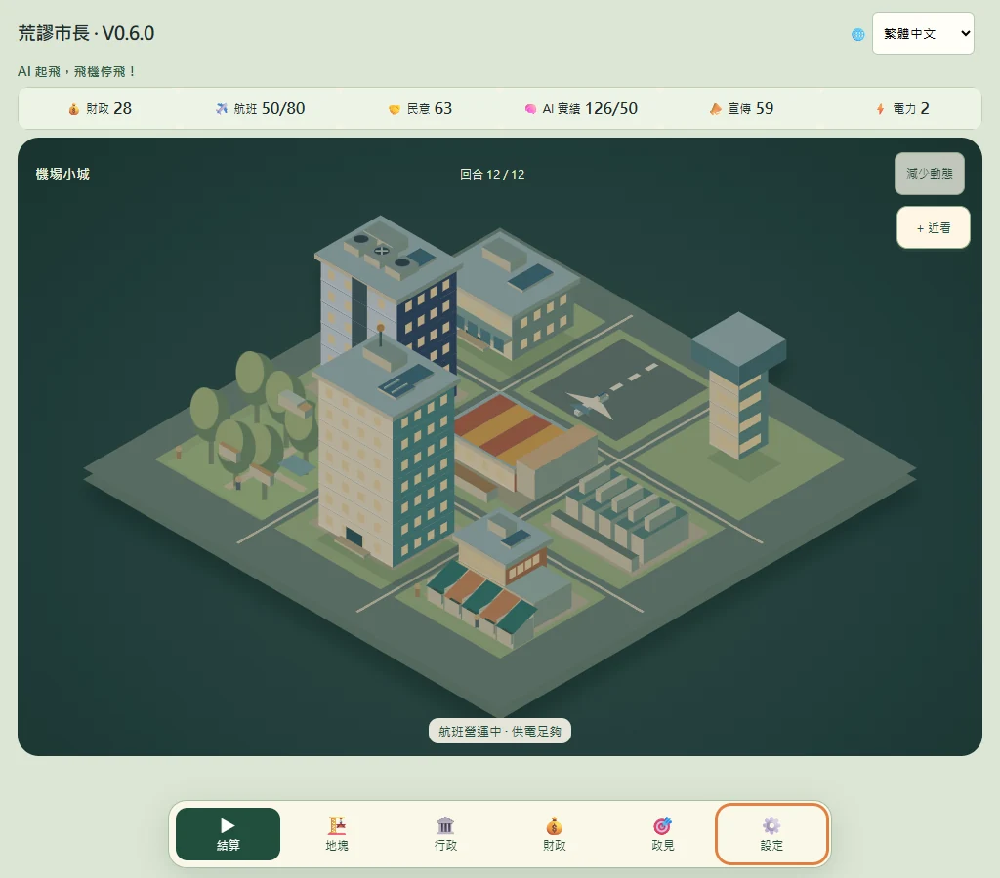

# 荒謬市長 · Absurd Mayor

**AI 起飛，飛機停飛！**

機場還在營運，市府卻宣布要改建成 AI 園區。你有 12 回合決定機場要留下多少、城市要花多少，以及競選承諾要如何兌現。這是一款以等角城市地圖為主的開源策略小品，支援繁體中文、English、Français、Nederlands。

**[展示網站](https://vrkatbekao-creator.github.io/absurd-mayor-ai-airport/) · [線上試玩 V0.6.0](https://vrkatbekao-creator.github.io/absurd-mayor-ai-airport/play.html) · [離線 HTML 檔](荒謬市長_v0.6.0.html)**

## 怎麼玩

1. **選政策。** 從三個選項中決定如何回應本回合的事件。
2. **做市政行動。** 選擇建設、升級、行政措施或暫緩行動。每回合最多做一項。
3. **結算。** 查看航班、財政、民意、AI 產業和政見結果。第 4、8、12 回合是任期里程碑。

從展示網站點選「下載離線版」，再用瀏覽器開啟 HTML 檔即可遊玩。進度儲存在目前瀏覽器的儲存空間，線上版、離線檔案與其他瀏覽器的進度可能各自獨立。

## V0.6.0

- 城市地圖成為主畫面。建築逐層成長，施工、完工和日夜變化會反映在地圖上。
- 政策、地塊、行政、財政與政見從底部浮窗開啟。插圖、圖表和關鍵數值先呈現重點，細節按需展開。
- 機場名目容量集中於財政的機場總覽。地塊顯示當次建設或升級的影響。
- 支援鍵盤操作和減少動態效果。玩法、經濟與存檔格式沿用前版。

本版通過 41 項核心測試、252 項 Chromium／Firefox／WebKit 測試，以及 12,000 組配對回歸。測試涵蓋三種寬度、四語、12 回合與存檔重載。人工視覺檢查使用 Chromium 截圖，實體裝置、真人讀屏與母語校訂未納入該次驗收。

[V0.6.0 合併紀錄](https://github.com/vrkatbekao-creator/absurd-mayor-ai-airport/pull/23) · [S4 驗收](QA_REPORT_v0.6.0-S4.md) · [CI](https://github.com/vrkatbekao-creator/absurd-mayor-ai-airport/actions/runs/42368986959/attempts/2)

## 版本與原始碼

- **V0.6.0 階段快照** · [S1](https://github.com/vrkatbekao-creator/absurd-mayor-ai-airport/tree/codex/snapshot-v0.6.0-stage-1) · [S2](https://github.com/vrkatbekao-creator/absurd-mayor-ai-airport/tree/codex/snapshot-v0.6.0-stage-2) · [S3](https://github.com/vrkatbekao-creator/absurd-mayor-ai-airport/tree/codex/snapshot-v0.6.0-stage-3) · [S4](https://github.com/vrkatbekao-creator/absurd-mayor-ai-airport/tree/codex/snapshot-v0.6.0-stage-4)
- **先前版本** · [V0.5.2.1](荒謬市長_v0.5.2.1.html) · [V0.5.2](荒謬市長_v0.5.2.html) · [V0.5.1.1](荒謬市長_v0.5.1.1.html) · [V0.5.1](荒謬市長_v0.5.1.html) · [V0.5.0](荒謬市長_v0.5.0.html) · [V0.4.2](荒謬市長_v0.4.2.html)
- **建置與測試** · [遊戲建置腳本](scripts/build-v060.py) · [V0.6.0 驗收流程](.github/workflows/v060.yml) · [網站原始碼](site/)

舊檔名 `v5.0`、`v5.1` 為歷史入口，對應正式版本 V0.5.0、V0.5.1。

歡迎在 [Issues](https://github.com/vrkatbekao-creator/absurd-mayor-ai-airport/issues) 回報問題。若能附上版本、瀏覽器、語言與重現步驟，會更容易定位。

## English

Absurd Mayor is a 12-turn, open-source city strategy game. A working airport is slated for conversion into an AI district. Choose policies, build or upgrade the city, and see which campaign promises you can keep. Play in Traditional Chinese, English, French or Dutch. The single-file HTML edition runs offline.

本專案採 [MIT 授權](LICENSE)。
